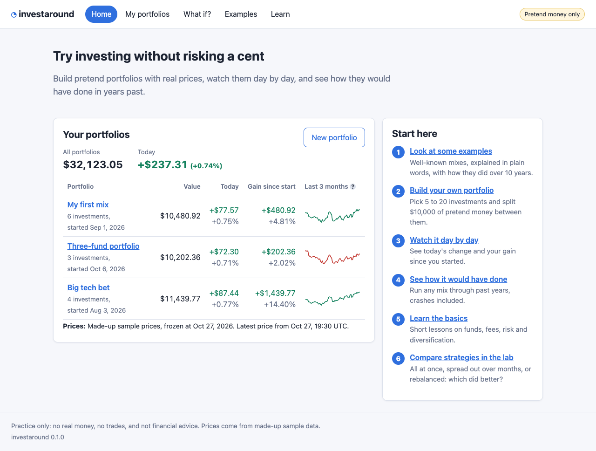

# investaround

Practice investing with pretend money and real prices.  Pick 5 to 20
stocks, funds or ETFs, split $10,000 of pretend money between them, and
watch how they do day by day.  Or run any mix through past years (2008
and 2020 crashes included) to see how it would have done.  Nothing is
really bought, nothing here is financial advice, and no account is
needed anywhere.



## How it was built

AI agents (Claude Code) wrote all of investaround from one prompt,
working inside Wing Pro 12.1, a Python IDE from
[Wingware](https://wingware.com/).  Wing's Tasks Manager is itself an AI
agent: it turns a request into a queue of tasks, gives each to a
separate coding agent, answers their questions, checks and commits their
work, and starts the next.  The prompt was written the way a new
investor who doesn't program might ask, without naming a data source, a
web framework or how to test it.  The agents chose those, and planned,
built and tested the app, up to four tasks at a time.  The run took
about an hour on October 27, 2026, from 3:19 pm to 4:13 pm, including
two follow-up requests, and made 19 tasks and 17 commits.

This was the prompt that started it:

> I'm new to investing and want some software so I can try it out by
> just picking investments without actually buying them and watching
> them over time, both in current values day to day and by setting the
> date range to see how they would have done in the past. I would pick
> around 5-20 investments, and would be useful to have some way of
> seeing examples to work from. I'm hoping to do this with real
> investments and prices from somewhere free where I don't need an
> account.  Anything else that would help a new investor to try and
> understand common strategies would also be great.
>
> Commit a screenshot of each major visible change under docs/shots/
> since we'll be creating a publishable trace of this run later.

When it was done, these two requests got it running from Wing:

> How do I run this?  Can you set the main entry point in Wing?

> Running in Wing doesn't work: [...] ImportError: attempted relative
> import with no known parent package

Before publishing, the price data the agents had recorded from Yahoo
Finance for the tests was replaced with made-up sample prices, so this
repository ships no market data, and it was removed from the history.

[run-trail/RUN.md](run-trail/RUN.md) is the run's full trail: every
task with its prompt, the questions and who answered them, the judgement
calls, the commits and screenshots, and the time and tokens each used,
followed by what went wrong along the way.
[run-trail/trail.json](run-trail/trail.json) has the same data.

## What's in it

- **Home**: all your portfolios with today's change and a 3-month
  sparkline, plus a "start here" path for new investors.
- **My portfolios**: build a portfolio with symbol search, then watch
  each holding's price, today's change and gain since you started.
- **What if?**: how a portfolio, example or quick mix would have done
  over 1, 5 or 10 years, the whole history, or a past crash, against
  the S&P 500.
- **Examples**: eight well-known portfolios (three-fund, 60/40,
  all-weather and others), explained in plain words with their risks.
  Copy any of them to try it yourself.
- **Learn**: short lessons, a glossary, and a strategy lab that
  compares investing all at once, spreading it out month by month, and
  rebalancing.

Screenshots of every page are in [docs/shots/](docs/shots/).

## Install

You need Python 3.12 or later.

```sh
python3 -m venv .venv
.venv/bin/pip install -r requirements.txt
```

To run the browser tests or regenerate the screenshots, you also need a
browser for Playwright.  An installed Google Chrome is used if there is
one.  Otherwise run:

```sh
.venv/bin/playwright install chromium
```

## Run

```sh
.venv/bin/python -m investaround
```

This starts the app at <http://127.0.0.1:8765/> and opens it in your
browser.  Press Ctrl-C to stop it.  `.venv/bin/python run_investaround.py`
does the same, for tools such as an IDE that run a script file rather
than a module (`investaround/__main__.py` can't be run as a plain
file).  Options:

| Option | What it does |
| --- | --- |
| `--port 9000` | use another port |
| `--source fake` | use made-up sample prices instead of live ones (works offline) |
| `--data-dir PATH` | keep portfolios and the price cache somewhere else |
| `--no-browser` | don't open a browser window |

`INVESTAROUND_PRICE_SOURCE` (`yahoo` or `fake`) and
`INVESTAROUND_DATA_DIR` do the same as `--source` and `--data-dir`.

## Where prices come from

Live prices come from **Yahoo Finance's public chart and search
endpoints**.  These are free and need no account, but they are
**unofficial**:

- Prices may be 15 minutes or more behind.
- Yahoo can change or block these endpoints at any time.  The app sends
  an honest User-Agent and caches heavily so it asks as little as
  possible.
- When Yahoo can't be reached or limits requests, the app falls back
  to cached prices where it has them.  Otherwise it says prices are
  unavailable, with a banner on the home page.

Past prices use adjusted closes, so dividends count as reinvested and
splits are accounted for.

`--source fake` uses made-up sample prices, kept in
`tests/fixtures/prices/`, which behave like a real market (the 2008,
2020 and 2022 crashes included) but are no real security's prices.
"Today" stays fixed at Oct 27, 2026.
The tests and screenshots use this source, so they never touch the
network.

## Where your data is stored

Everything stays on your computer in `data/`, which git ignores, or
wherever `--data-dir` points:

- `data/portfolios.json`: your portfolios.  It's plain JSON, so you can
  back it up or copy it to another machine.
- `data/prices.sqlite`: the price cache.  You can delete it at any
  time; it fills up again as needed.

## Development

```sh
.venv/bin/python -m pytest tests/unit        # fast, no browser
.venv/bin/python -m pytest tests/ui          # drives the app in headless Chrome
.venv/bin/python tools/shots.py              # regenerate docs/shots/*.png
.venv/bin/python tools/shots.py --list       # list the screenshots
```

`tools/generate_fixtures.py` writes the sample prices; the same seed
always writes the same files.

## License

MIT; see [LICENSE](LICENSE).  Prices fetched from Yahoo Finance while
the app runs are not part of this repository and are subject to Yahoo's
terms.
